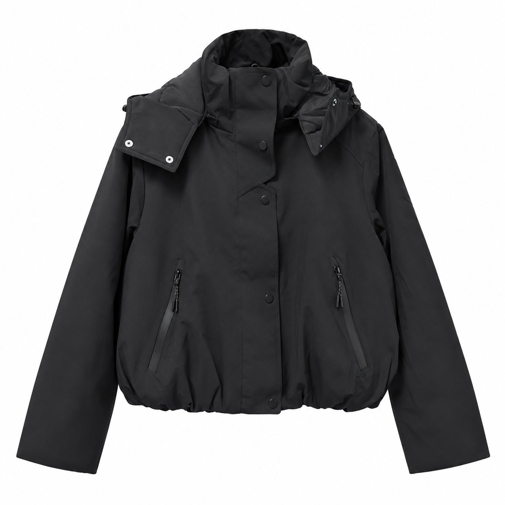
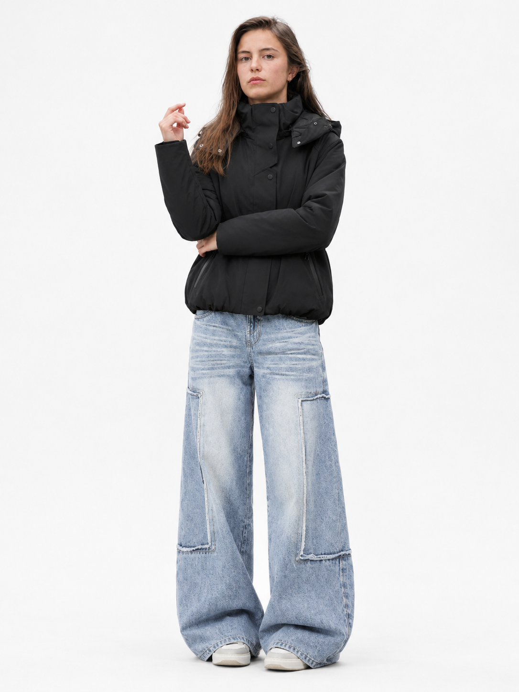
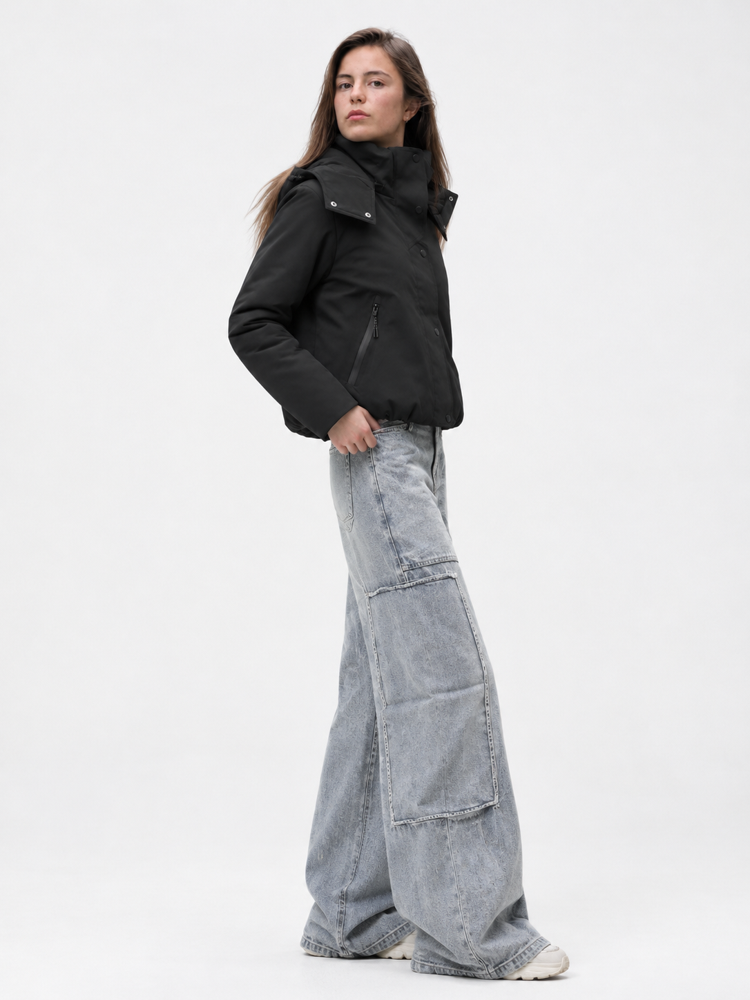
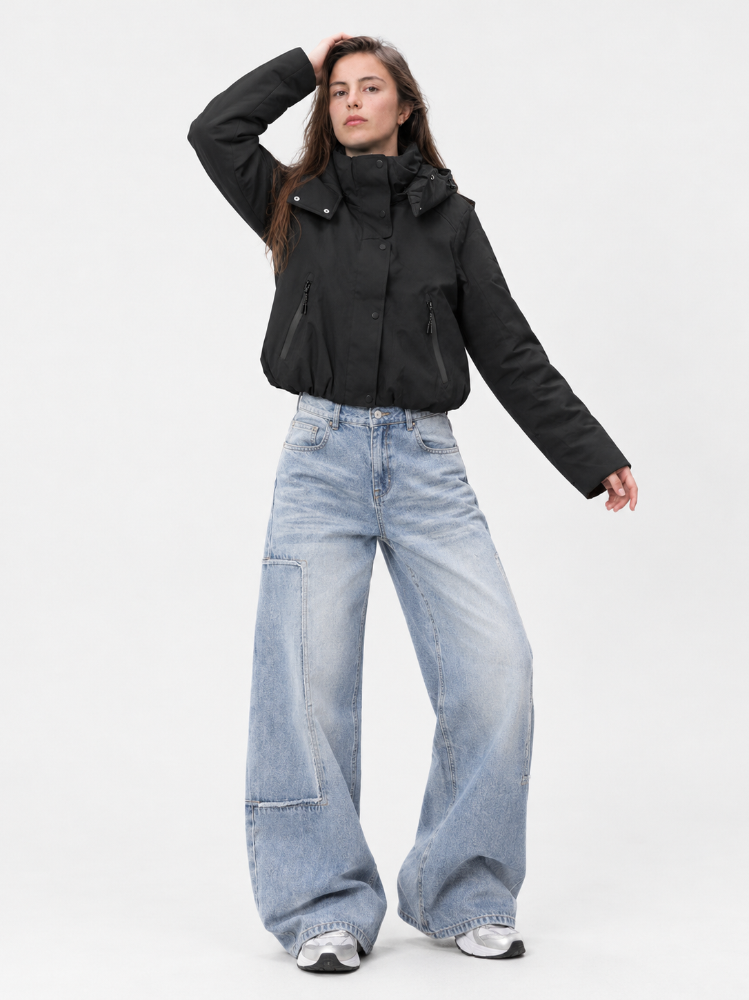
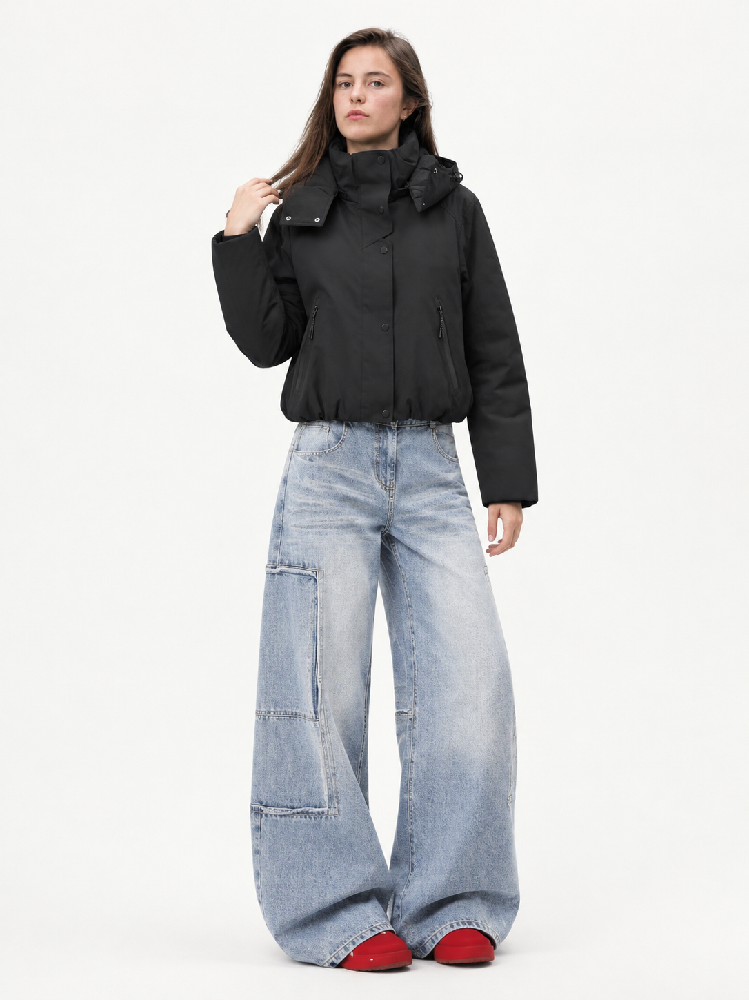
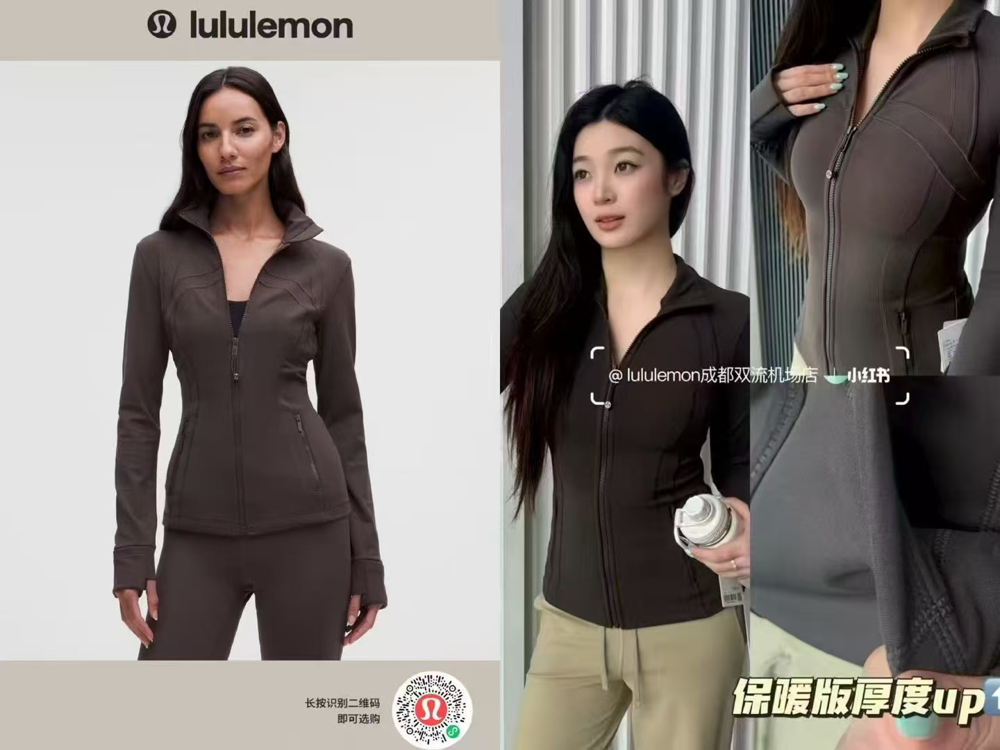
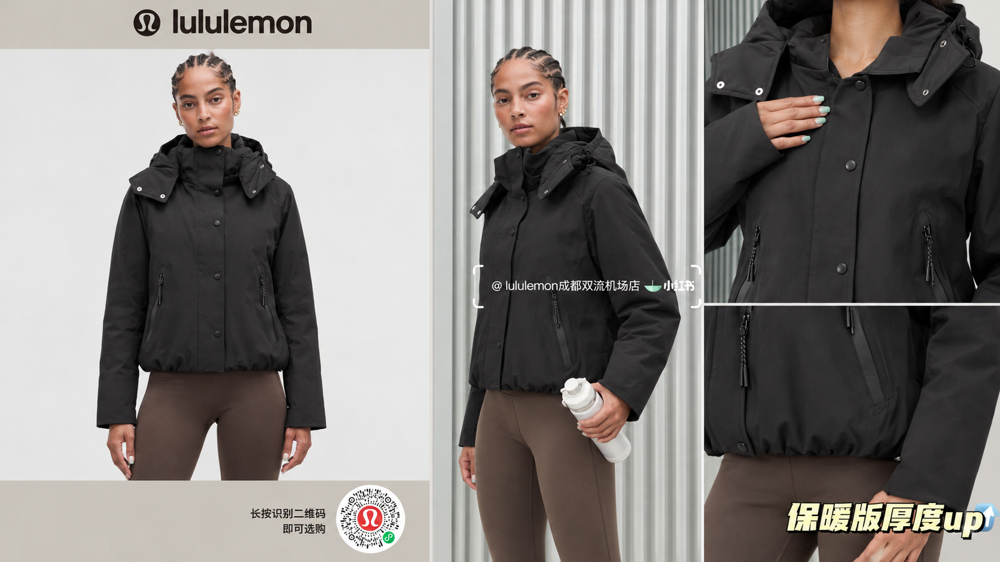
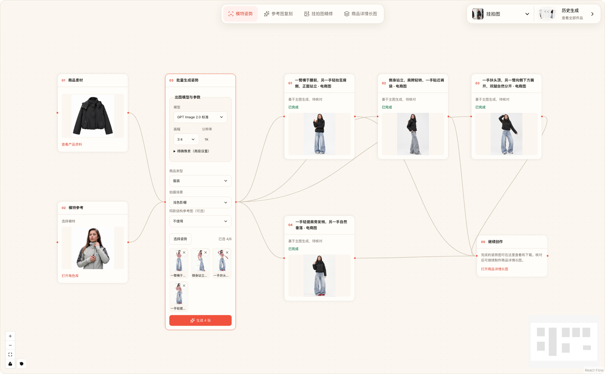

# BriefOnce — AI Ecommerce Product Images & Creative Workflows

[中文](README.md) · [Website](https://tian1363.github.io/briefonce-open/en/) · [Creative Skills](https://tian1363.github.io/briefonce-open/skills/) · [Examples](docs/examples/apparel-images.md)

Keep product photos, facts and creative references together. Create model pose images, refine product photos, and generate product detail images in visual workflows. Develop scripts and video tasks in chat. Built for apparel and footwear brands, ecommerce teams and creators; runs locally or on your own server.

## Real results

### One jacket, four poses

<table>
  <tr><th>Product reference</th><th>Front</th><th>Side</th><th>Raised arm</th><th>Relaxed stance</th></tr>
  <tr>
    <td width="20%"></td>
    <td width="20%"></td>
    <td width="20%"></td>
    <td width="20%"></td>
    <td width="20%"></td>
  </tr>
</table>

*Actual outputs, without retouching. Product appearance, model identity and body position use separate references.*

### Reference recreation · Development preview

Keep a reference layout while replacing the product and model. This actual test demonstrates a scene that is not yet included in the public release.

<table>
  <tr><th>Reference</th><th>Generated result</th></tr>
  <tr>
    <td width="50%"></td>
    <td width="50%"></td>
  </tr>
</table>

*Third-party brand marks come from the reference material; this is not a brand partnership. [See the case](docs/examples/reference-recreation.md).*



*Actual interface capture with filenames and billing information hidden. The toolbar includes development scenes; currently released features are listed below.*

## What you can do

| Goal | Workflow or tool |
| --- | --- |
| Show one product in several model poses | **Model poses** — shared product references, one image per selected pose |
| Turn a hanging photo into a product image | **Product photo refinement** — white background and visible-detail close-ups |
| Create a product detail image | **Product detail images** — choose an actual layout reference, product facts and a platform |
| Organize material from a reference video | **Video asset extraction** — preview extracted assets and import them into product context |
| Understand image, video and social-post references | **Creative interpretation** — develop a direction using the accessible reference content |

Pose images guide body position only. Product appearance and model identity come from their respective references. Tools and image workflows have dedicated entry points; chat currently focuses on scripts and video creation.

## Reusable creative Skills

- [Hook Replication](https://tian1363.github.io/briefonce-open/skills/hook-replication/)
- [UGC Hooks](https://tian1363.github.io/briefonce-open/skills/ugc-hook-writer/)
- [Product Benefits in Context](https://tian1363.github.io/briefonce-open/skills/product-selling-point-writer/)
- [Script Review](https://tian1363.github.io/briefonce-open/skills/script-review/)

Each page includes an input example and the complete prompt. If these workflows help, **Star the repository** to keep it handy, or [share a use case](https://github.com/tian1363/briefonce-open/discussions).

## Run locally

Requires Go 1.27.2+, Node.js 20.19+ or 22.12+, and npm.

```bash
git clone https://github.com/tian1363/briefonce-open.git
cd briefonce-open
npm --prefix web/app ci
npm --prefix web/app run build
SCRIPT_AGENT_MODE=mock go run ./cmd/server
```

Open <http://127.0.0.1:8080/> and create an account. Mock mode uses placeholder results to demonstrate the flow. Configure your own model services for real generation; video extraction also needs FFmpeg and ffprobe.

## Explore and contribute

[User guide](docs/product-user-manual.md) · [Model configuration](docs/model-capabilities.md) · [Deployment](docs/managed-deployment.md) · [Contributing](CONTRIBUTING.md) · [Security](SECURITY.md)

Go backend, React frontend and SQLite. Account data is isolated. Xiaohongshu reading depends on the connected browser, login session and accessible page content.

Code is licensed under [Apache-2.0](LICENSE). See the [visual asset notice](ASSET-NOTICE.md) for image references.
