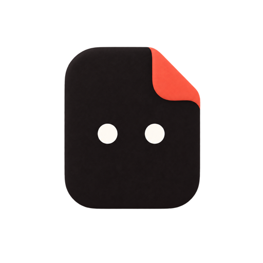

<p align="center"></p>

<h1 align="center">BriefOnce</h1>
<p align="center"><strong>一份商品资料，开始下一次创作。</strong></p>
<p align="center">AI 电商商品图、模特姿势与详情页工作流。<br />Self-hosted AI workspace for ecommerce product images and creative workflows.</p>

<p align="center">
  <a href="https://github.com/tian1363/briefonce-open/actions/workflows/ci.yml"></a>
  <a href="LICENSE"></a>
  <a href="https://github.com/tian1363/briefonce-open/stargazers"></a>
</p>

<p align="center"><a href="https://tian1363.github.io/briefonce-open/">官网与示例</a> · <a href="#本地体验">本地体验</a> · <a href="https://tian1363.github.io/briefonce-open/skills/">创作 Skill</a> · <a href="docs/product-user-manual.md">使用手册</a> · <a href="README.en.md">English</a></p>

把商品图片、卖点和参考素材放在一起，用工作流制作商品展示图，用创意对话推进脚本与视频。适合服装、鞋履品牌、电商团队和内容创作者，也支持本地运行与自托管。

## 看看实际生成的样子

### 一件外套，四个姿势

<table>
  <tr><th>商品参考</th><th>正面站姿</th><th>侧身站姿</th><th>抬手展示</th><th>自然站姿</th></tr>
  <tr>
    <td width="20%"></td>
    <td width="20%"></td>
    <td width="20%"></td>
    <td width="20%"></td>
    <td width="20%"></td>
  </tr>
</table>

*真实生成结果，未经修图。商品、人物身份与动作分别使用对应的参考素材。*

### 参考图复刻 · 开发预览

保留参考画面的构图，换上自己的商品与模特。以下为实际测试结果；这个场景尚未包含在当前公开版本中。

<table>
  <tr><th>参考画面</th><th>替换商品与模特后的结果</th></tr>
  <tr>
    <td width="50%"></td>
    <td width="50%"></td>
  </tr>
</table>

*画面中的第三方品牌标识来自参考素材，不代表品牌合作。[查看完整案例](docs/examples/reference-recreation.md)。*

## 当前公开版本

| 你想完成的事 | 从这里开始 |
| --- | --- |
| 给同款商品做不同姿势的模特图 | **模特姿势**：多张商品图共同作为参考；选几个姿势，生成几张图 |
| 把挂拍素材整理成商品展示图 | **挂拍图精修**：白底图与可见细节特写 |
| 为服装或鞋履制作商品详情页 | **商品详情长图**：按品类、卖点和平台选参考图，由 AI 策划并生成 |
| 从参考视频中整理可复用素材 | **视频素材提取**：预览解析结果，再导入产品资料 |
| 理解图文、图片与视频创意 | **创意解读**：结合参考内容与产品背景继续创作 |

### 在工作流里连接素材与结果


*实际工作流截图，已隐去文件名与计费信息。截图含开发中的场景入口；公开版支持上表所列功能。*

## 跟着一个例子开始

- [一件外套，制作一组模特姿势图](docs/examples/apparel-images.md)
- [从商品卖点到详情页参考与出图](docs/examples/product-detail.md)
- [从参考视频提取素材，再继续创作](docs/examples/video-extraction.md)

## 可直接复用的创作 Skill

| Skill | 适合什么时候用 |
| --- | --- |
| [开头钩子复刻](https://tian1363.github.io/briefonce-open/skills/hook-replication/) | 理解参考视频开头的结构，再为自己的商品设计原创开头 |
| [UGC 开头](https://tian1363.github.io/briefonce-open/skills/ugc-hook-writer/) | 把真实使用场景写成首帧、口播与产品承接 |
| [场景化卖点表达](https://tian1363.github.io/briefonce-open/skills/product-selling-point-writer/) | 把商品事实转成用户容易理解的具体收益 |
| [脚本优化检查](https://tian1363.github.io/briefonce-open/skills/script-review/) | 检查开头、卖点、镜头与行动指引 |

这些页面包含使用方法、输入示例和完整提示词。觉得有用，欢迎 **Star 收藏**；有具体需求，可以[提出建议](https://github.com/tian1363/briefonce-open/discussions)。

## 本地体验

需要 Go 1.27.2+、Node.js 20.19+ 或 22.12+，以及 npm。

```bash
git clone https://github.com/tian1363/briefonce-open.git
cd briefonce-open
npm --prefix web/app ci
npm --prefix web/app run build
SCRIPT_AGENT_MODE=mock go run ./cmd/server
```

打开 <http://127.0.0.1:8080/>，注册账号后体验工作台。演示模式无需模型 Key，使用占位结果展示流程。真实生成请配置自己的模型服务；视频素材提取需要 FFmpeg 和 ffprobe。

## 使用与开发

- [产品使用手册](docs/product-user-manual.md)：产品资料、工具、工作流与作品库。
- [模型配置](docs/model-capabilities.md)：连接文本、图片与视频能力。
- [部署指南](docs/managed-deployment.md)：运行与持久化存储。
- [贡献指南](CONTRIBUTING.md)：报告问题、提交案例和改进代码。
- [安全说明](SECURITY.md)：私密报告安全问题。

Go + React + SQLite。产品资料可在后续创作中复用，账号之间的数据相互隔离。小红书读取取决于浏览器连接、登录状态和页面实际可访问内容。

代码采用 [Apache-2.0](LICENSE)；图片与参考素材见[素材说明](ASSET-NOTICE.md)。
