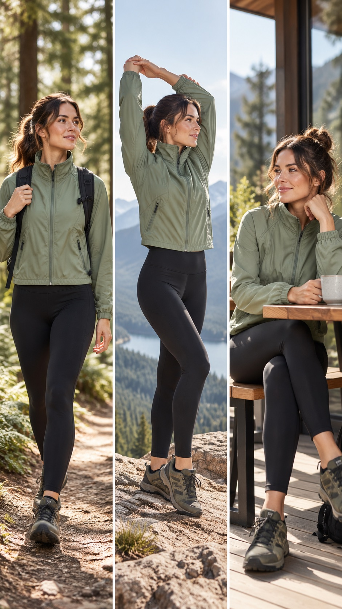

# 一件外套，制作一组模特姿势图

适合服装新品需要正面、侧面、背面或动态展示的场景。

*图为创作方向示意，可按下面的步骤准备自己的商品。*

1. 在产品资料里上传同款商品的清晰图片，写明目标颜色与已确认的款式信息。
2. 进入“模特姿势”工作流，选择商品参考图与模特。
3. 打开姿势库，查看预览并选择动作，例如正面站立、侧面站立、自然走动。
4. 选择图片模型与比例后生成，在作品库检查结果并下载。

多张商品图共同描述一件商品。选择三个姿势，就生成三张图；姿势参考只约束动作，服装与人物身份分别来自商品图和模特图。

如果同款的正反面来自不同颜色，应确认它们确实同款，并明确目标颜色。缺失视角中的结构属于生成推断，发布前需与实物核对。

[查看使用手册](../product-user-manual.md) · [返回项目](../../README.md)
