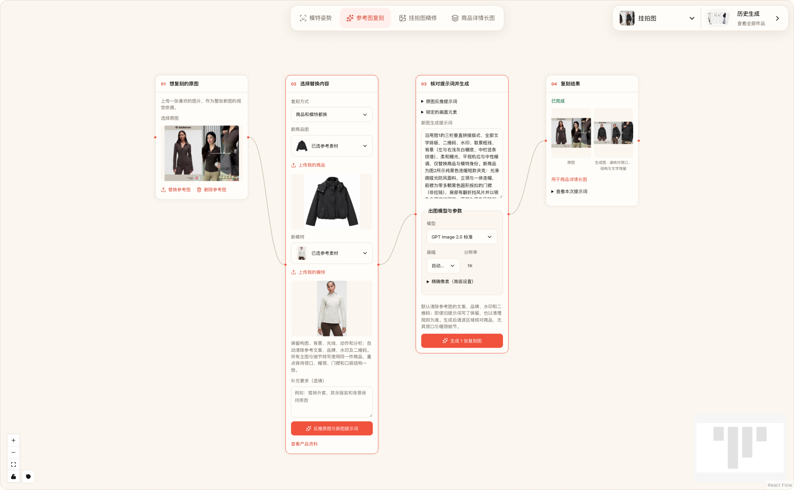

# 保留参考构图，换上自己的商品与模特

开发预览：以下为实际任务结果。参考图复刻场景尚未包含在当前公开版本中。

1. 选择一张参考画面，明确希望保留的构图与展示方式。
2. 提供要替换的商品图与模特参考图。
3. 分析参考图，核对并调整生成提示词。
4. 生成新的图片，对照商品检查服装结构与画面文字。

本例更换了商品与模特身份，保留三栏构图、动作和细节展示位置。图片是原始生成结果，未做后期修图。

画面中的品牌、水印和二维码继承自参考素材，不代表品牌合作或授权宣传案例。

*工作流截图已隐去文件名与计费信息。*

[查看使用手册](../product-user-manual.md) · [返回项目](../../README.md)
