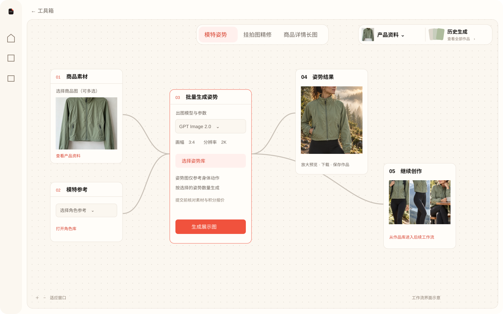

# BriefOnce 产品使用手册

更新日期：2026-10-15。面向使用产品资料、工具与工作流完成创作的用户。

## 1. 进入产品

自托管默认地址为 `http://127.0.0.1:8080/`；当前维护电脑的本地实例为 `http://127.0.0.1:18080/`。公网使用部署者提供的域名。[官网](https://tian1363.github.io/briefonce-open/)用于介绍产品，不是登录后的工作台。

使用运营人员发放的账号登录。看不到注册入口或无法注册时，联系运营人员获取账号或邀请码。不要把模型密钥放进输入框或产品资料。

## 2. 先整理产品资料

1. 创建或选择产品，填写名称、已确认卖点、材质、规格及使用说明。
2. 上传商品图片、文档和参考素材。缺少事实时补充说明，不把 AI 推测当作真实规格。
3. 点击素材图片放大预览；鼠标悬停、键盘聚焦或触屏操作时使用素材操作入口。
4. 替换支持的图片资产时选择本地图片；历史作品不会因替换而被覆盖。
5. 移除素材只解除当前产品资料的关联，不会删除作品库中的历史生成记录。

同款异色可以共同提供结构参考，但要明确目标颜色、正反面与需保留的细节。缺失部位由 AI 补全时，应对照实物核验后使用。

## 3. 两个工具

### 视频素材提取

进入“工具 → 视频素材提取”，按页面支持方式添加视频并提交。解析完成后查看全部成功资产、图片预览及描述，再一键导入产品资料。检查导入结果，失败项按提示处理，避免重复导入。

视频抽帧和片段提取依赖服务器安装 FFmpeg。提取到的参考画面、人物、场景或标识不等于拥有对素材的商业使用授权。

### 创意解读

提交参考图片、视频或支持的链接，核对读取内容后进行解读。小红书链接可能需要连接已登录浏览器；登录失效、页面不可访问或读取不完整时，按提示重新连接，或补充原始图文。解析不完整时不要把解读当作全文分析。

## 4. 四个工作流

### 模特姿势

1. 选择商品图，多张图共同作为同一商品的参考。
2. 选择或上传模特，打开姿势库弹窗查看预览并选择动作。
3. 配置场景、图片模型、比例等参数，检查预计积分后生成。
4. 选几个姿势就生成几张图，不按商品图数量相乘。每张姿势图仅用于参考动作，不用于替换商品或模特身份。
5. 对照商品的颜色、结构、口袋和细节检查结果。

### 参考图复刻

1. 上传想复刻的原图，选择保留主体、只换商品、只换模特或同时替换。
2. 选择或上传自己的商品图、模特图，补充需要保留的细节。
3. 点击「反推原图与新图提示词」，查看原图描述与锁定元素，核对并修改新图提示词。
4. 确认模型与预计消耗后，生成一张复刻图。更换素材或补充要求后需重新分析。
5. 对照原图检查结果，可下载或带入详情长图；作品会自动保存。AI 会尽量保留其余视觉元素，但不保证逐像素一致，反推也不等于原作者真实提示词。

### 挂拍图精修

选择真实商品挂拍图，选择白底展示或可见细节等处理方式，设置模型后生成。检查结果是否保留商品结构；输入中不可见的细节不能视为真实商品证据。

### 商品详情长图

1. 在商品素材节点选择商品图片，核对商品信息节点中的卖点和规格。
2. 选择平台、创作方向，在视觉参考图节点打开模板库，查看实际参考图后选择。
3. 进入 AI 策划与出图，检查内容并选择整页或按屏生成，确认模型和预计消耗。
4. 生成后在结果节点或作品库预览和下载。模板图片用于版式、配色与构图参考，商品事实来自产品资料。

整页图不等同于各平台最终上传包；发布前核对文字、尺寸与平台要求。不要照搬参考品牌标识或把参考商品细节带入自己的商品。

### 画布操作

上方场景栏切换工作流，右侧选择产品及进入历史作品库。初次进入适配全部节点；可拖动、缩放，使用重置视图恢复概览。手动调整视图不会删除历史作品。

## 5. 作品库与下载

从画布右上角的历史生成入口进入作品库，按产品查看结果。点击图片预览、点击下载并观察页面提示与浏览器下载记录。将适合的作品用于后续详情页或其他创作。

下载失败先查看任务是否完成、文件是否仍可访问，以及浏览器是否阻止下载；向运营反馈任务编号和错误提示，不反复提交付费任务。

## 6. 对话、创意空间与视频

创意空间保存长期目标和关联产品；在输入框说明任务并持续修改。当前输入框以视频生成链路为主，其他图片工作流与工具从专用入口使用。

视频选择页以当前启用模型、参数和报价为准。新接入的视频型号尚待真实定价与出片验收，未启用档位不能提交。提交前核对参考素材、比例、时长及积分，提交后在任务记录查看状态和结果。

## 7. 积分与常见问题

| 情况 | 处理方式 |
| --- | --- |
| 不能生成 | 检查余额、账号有效期、每日额度及模型档位；联系运营核对配置 |
| 扣分后尚无结果 | 保存任务编号，等待查询或联系运营；上游状态不明时不要重复提交 |
| 人物或商品不一致 | 补充清晰参考、区分素材用途，检查颜色与正反面信息后重试 |
| 模板没有图片或图片加载失败 | 换选可预览模板或补充自己的参考图，不凭名称盲选 |
| 账号密码忘记 | 联系运营人员重置；旧会话会失效 |

生成作品发布前请核对事实、文字、商标与商品外观。相关入口：[文档中心](README.md)。
